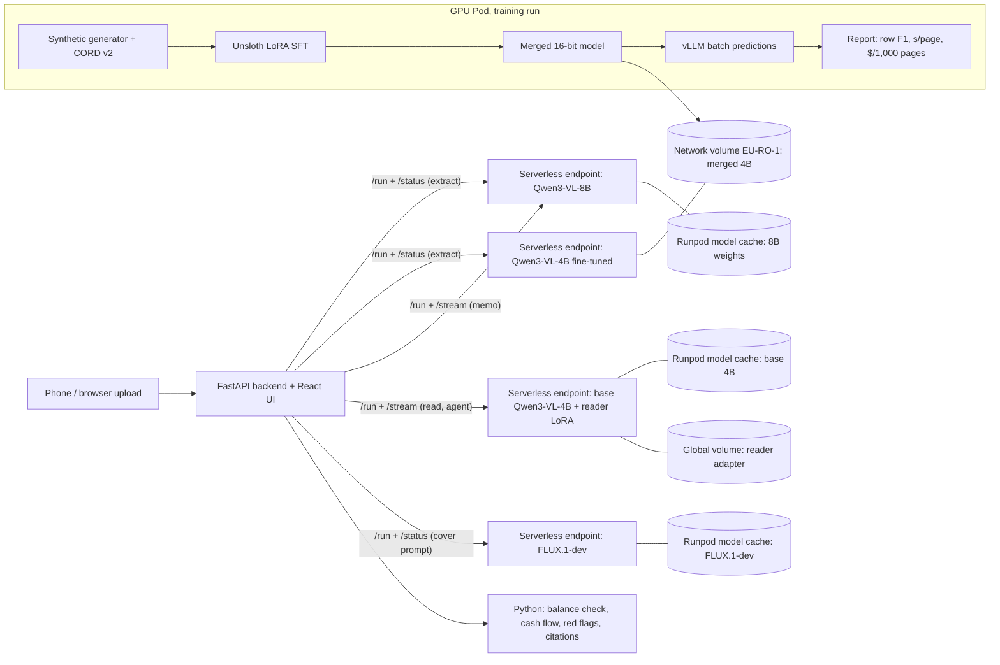

# LedgerLens

**Phone photos of messy small-business bank statements and invoices go in; checked transaction
rows, a cash-flow analysis, cited red flags and a credit memo come out.** Open vision models
(Qwen3-VL) run on **Runpod Serverless**, and FLUX.1-dev draws the memo's cover illustration, so a Southeast Asian lender can keep confidential documents
off US-hosted APIs and pay a known price per page.

The ML question behind it: *can a 4B model, LoRA fine-tuned on our own synthetic documents, match
an 8B model zero-shot on extraction quality (row F1), speed and cost per 1,000 pages?*

> Everything here is fictional: synthetic businesses and fictional banks. The only real documents
> are the public CORD v2 receipts (CC BY 4.0).

## Runpod Serverless checklist

| A Serverless worker needs | Where it is |
|---|---|
| A `handler.py` for serverless requests | [`worker/handler.py`](worker/handler.py): starts vLLM once per worker, then serves `generate` (plain prompt to text), `extract` (page image to checked JSON), `memo` (streamed text), `read` (page triage and reading), `agent` (chat) and `health`. [`image_worker/handler.py`](image_worker/handler.py): loads FLUX.1-dev once per worker, then serves `image` (text prompt to JPEG/PNG) and `health` |
| A Docker image with the handler and the model | [`worker/Dockerfile`](worker/Dockerfile) loads weights from model cache / volume for the three LLM endpoints; [`worker/Dockerfile.baked`](worker/Dockerfile.baked) bakes weights into the image (not yet built); [`image_worker/Dockerfile`](image_worker/Dockerfile) for FLUX, weights from the model cache |
| A deployed Serverless endpoint | 8B `szucrtrufff80a`, fine-tuned 4B `5078uudfkeaw2v`, base 4B `cuvgn5z2av09my` serves the credit assistant, FLUX.1-dev `qj707h1pdzzpez` draws memo covers |
| Accept an input, return a generated output | `{"input":{"task":"generate","prompt":"..."}}` returns generated text; a bare `prompt` goes to the chat agent on the agent endpoint; `{"input":{"prompt":"..."}}` on the FLUX endpoint returns a generated image. Document tasks return validated JSON rows and a streamed credit memo. [Call it with curl](#call-the-endpoint-with-curl) |
| Show it working | The demo app (`app/`, with a 3-minute Presenter tour) calls the live endpoints |
| Code, configuration and clear docs | This README, [`worker/README.md`](worker/README.md), [`docs/REPORT.md`](docs/REPORT.md), [`docs/BUILD_LOG.md`](docs/BUILD_LOG.md), [`docs/DECISIONS.md`](docs/DECISIONS.md) |

**Two ways to ship the model.** The three LLM endpoints use `worker/Dockerfile` and load
weights from Runpod storage:

- **8B:** Runpod's **model cache**. 16.3 GiB of weights load in 5.7 s with no download,
  keeping the image small and builds and worker pulls fast.
- **Fine-tuned 4B:** a **network volume**, where the training Pod wrote the merged weights.
  Swapping in a new fine-tune needs no rebuild or upload; the volume pins it to one data centre.
- **Agent, base 4B:** Runpod's **model cache** plus the trained reader as a **LoRA adapter**
  on the beta **global volume** `ledgerlens-global`. Workers can start in any data centre;
  the compile cache stays on container disk because global storage has no locking or atomic rename.
- **FLUX.1-dev (image endpoint):** Runpod's **model cache** (gated model, so the endpoint carries
  a Hugging Face token). The image is built by GitHub Actions and pulled from GHCR, because
  Runpod's GitHub builder failed to start on 17 Oct (see the build log).

`worker/Dockerfile.baked` downloads the pinned 8B weights during the build and sets
`MODEL_PATH=/models/model` and `HF_HUB_OFFLINE=1`. It includes both the handler and model,
with no network volume, so the endpoint is not pinned to one data centre. The trade-off is
an image about 16 GiB larger and slower builds and pulls. It has not yet been built, and its
cold start has not been measured.
Health reports `model_source: "baked"`.

## What it does

1. **Extract.** A page image goes to a Serverless endpoint. vLLM reads it into a strict JSON schema
   (structured decoding), validated with Pydantic.
2. **Check.** Code, not the model, checks every row against the printed running balance. A row
   whose balance proves the money went the other way is moved between debit and credit and
   flagged; rows that still don't add up are shown red for the analyst.
3. **Analyse.** Code computes monthly cash flow, balances, customer concentration and red flags
   (returned cheques, round trips, large cash deposits…). Every figure cites its page and row.
4. **Write.** The model writes the memo prose from those computed numbers only, streamed over
   `/stream`. Citations in the memo jump back to the evidence row.
5. **Cover.** FLUX.1-dev draws a cover illustration of the business (a text prompt in, an image
   out). Code builds the prompt from a fixed template (industry from invoice keywords, country from
   the currency), so no document text reaches the image model. The app draws the figures on top
   and labels the picture as an illustration, not evidence.

### Credit assistant

The `/assistant` page answers credit questions and writes cited memo cards with live steps, Stop and Logs.
One base Qwen3-VL-4B engine serves the router (a structured JSON plan), page triage and writer.
The trained reader runs as a LoRA adapter; Python computes the analysis between model steps.
The data agent uses read-only tools with tool calling for at most 3 rounds.
The writer fills five memo sections in parallel; code checks figures, citations, headings and length,
and each section can be rewritten at most once. See [Chat and page reading](worker/README.md#chat-and-page-reading).

## Architecture



## Runpod setup

| Piece | Choice | Why |
|---|---|---|
| Worker | `worker/handler.py`: a generator handler that starts `vllm serve` in-process at cold start; tasks `generate`, `extract`, `memo`, `read`, `agent`, `health` | One engine per worker; streaming memo over `/stream` |
| Image | `worker/Dockerfile` on `vllm/vllm-openai:v0.31.0-cu129`, built by Runpod's GitHub integration from the `deploy` branch | No local Docker; pushes to `main` never rebuild by accident (`scripts/release-worker.sh` ships) |
| 8B weights | Runpod **model cache** (`Qwen/Qwen3-VL-8B-Instruct`, pinned commit) | 16.3 GiB loaded in 5.7 s; no download at cold start |
| Fine-tuned 4B weights | **Network volume** (`MODEL_PATH`), same image and template | No rebuild or upload to swap models; pins the endpoint to EU-RO-1 |
| Agent endpoint | `cuvgn5z2av09my`: base 4B model cache + reader LoRA on global volume `ledgerlens-global` | One engine for chat and reading; workers can start in any data centre |
| Image endpoint | `qj707h1pdzzpez`: `image_worker/Dockerfile` (PyTorch 2.8 + diffusers), image from GHCR, FLUX.1-dev from model cache; 48 GB GPUs first (A40 / A6000), then 32 GB PRO with CPU offload; max 1 worker | FLUX.1-dev is ~34 GB in bf16, so 48 GB runs it fully on GPU |
| Scaling | Active 0, max 2, idle 60 s, FlashBoot on, queue-delay scaling 4 s, timeout 600 s | Nothing bills while idle. For a demo, the app's GPU switch keeps one worker on the Assistant or on every endpoint, on a shutoff timer, and calls an endpoint ready only after a `health` job answers |
| GPUs | 32 GB class (RTX 5090 / RTX PRO 4500), CUDA ≥ 12.9; the 4B agent endpoint also allows 24 GB pools (it has run on RTX PRO 6000 Blackwell MIG 1g.24gb) | The 8B in bf16 fits 32 GB at 8,192 tokens; older drivers can't start the image |
| Safety | Image size checked before decoding (decompression bombs); engine start failures fail jobs fast with the error instead of crash-looping paid workers | Both found or hardened during the build (see `docs/BUILD_LOG.md`) |

### Measured (8B, RTX 5090, 9 Oct)

| | Value |
|---|---|
| Warm statement page | 13.7–15.1 s execution, 0.13–1.4 s queue |
| Cold start | ~3.5 min (torch.compile ~27 s and CUDA-graph capture ~63 s are the big parts) |
| Serverless cost, warm | ≈ **$6.0–6.6 per 1,000 pages** at $0.000439/s |

## Results: 8B zero-shot vs 4B zero-shot vs 4B fine-tuned

All three on the same GPU (RTX PRO 4500), same prompt, schema and pixel cap. Row F1 = rows read
exactly right (statements: date, debit and credit; invoices and receipts: description, quantity,
unit price and amount), from the model's own answer; precision and recall are within 1.5 points
of each other on every set, so the models rarely invent or drop rows. Full results, breakdowns and failure analysis:
[`docs/REPORT.md`](docs/REPORT.md).

| | 8B, no training | 4B, no training | **4B fine-tuned** |
|---|---:|---:|---:|
| Unseen statement layouts (1,499 pages) | 0.578 | 0.614 | **0.965** |
| Seen layouts, new businesses (291) | 0.823 | 0.745 | **0.960** |
| Real CORD receipts (98) | 0.396 | 0.259 | **0.765** |
| Red flags found (unseen layouts) | 0.66 | 0.63 | **0.96** |
| Seconds per page, batched | 2.58 | 1.72 | **1.28** |
| $ per 1,000 pages, batched ($0.72/h) | 0.52 | 0.34 | **0.26** |

Served live on Serverless (warm, one page at a time): 8B ~14 s per page (≈ $6 per 1,000), fine-tuned
4B 7–11 s depending on the GPU it gets (RTX 5090 / 4090; ≈ $3 per 1,000 either way). The fine-tune's weak spot is heavy photo damage (row F1 0.87).

**Phone photos of printed pages** (18 pages, live on Serverless, RTX 5090; the photos came through a
chat app at about 1.1 MP, so this measures camera plus compression):

| Same 18 pages, row F1 | 8B, no training | 4B, no training | **4B fine-tuned** |
|---|---:|---:|---:|
| Clean | 0.671 | 0.723 | **0.984** |
| Phone photo | 0.411 | 0.258 | **0.672** |
| Page adds up, photo | 0 of 18 | 0 of 18 | 0 of 18 |
| $ per 1,000 pages, photo (live) | $5.03 | $3.77 | **$2.37** |

The fine-tune still leads by a wide margin, but real photos cost it about 0.3 of row F1 and no
photographed page reconciles, so every photo goes to an analyst. Its three zero pages: months read as
January, a rupiah amount read as decimals, and an impossible date (details in the report).

## Data

- **Synthetic statements and invoices** (`src/ledgerlens/datagen`): 400 fictional businesses in
  Singapore, Malaysia and Indonesia, six months of seeded cash flow each, local currencies and
  payment rails, mixed-language descriptions, planted anomalies (about 27% of businesses clean),
  6 statement layouts and 2 invoice layouts, rendered in headless Chromium with seeded phone-photo
  damage. Answers are exact because the generator printed them.
- **Real receipts:** CORD v2 (Indonesian receipts, CC BY 4.0). Its train split goes into training;
  its test split is a held-out real-document test.
- **Leakage guards:** splits by business; two statement layouts appear only in test.

| Split | Synthetic | CORD | Total |
|---|---|---|---|
| Train | 2,396 | 771 | 3,167 |
| Validation | 289 | 99 | 388 |
| Test | 1,790 (1,499 unseen-layout, 291 seen-layout) | 98 | scored separately |

## Run it

```sh
uv sync && uv run ruff check . && uv run ruff format --check . && uv run pytest -q
```

- **Demo app, offline** (cached sample results): see `app/README.md`; `DEMO_MODE=1`, port 8090.
- **Demo app, live:** set `RUNPOD_ENDPOINT_8B`, `RUNPOD_ENDPOINT_FT`,
  `RUNPOD_ENDPOINT_AGENT=cuvgn5z2av09my` and `RUNPOD_ENDPOINT_IMAGE=qj707h1pdzzpez`; the key is read from
  `runpodctl`'s config, never from the browser.
- **One page from the command line:**
  `uv run python worker/client.py extract --endpoint-id <id> --image page.png --doc-type statement`
- **Training and evaluation on a GPU Pod:** `train/README.md` and `train/run_pod.sh`
  (`train/run_pod.sh` runs every stage, resumable by stage markers).

### Call the endpoint with curl

Works the same from Postman. Use `/run` and poll `/status`: `/runsync` holds one connection for the
whole job, and Runpod dropped it during a cold start. Workers scale to zero when idle, so the first
call can take 3 to 10 minutes while a worker starts.

```sh
export RUNPOD_API_KEY=<your key>   # never commit it
EP=szucrtrufff80a                  # 8B; the fine-tuned 4B is 5078uudfkeaw2v

# 0. Send a plain prompt, then poll until COMPLETED; output is a one-item list with generated text
curl -s -X POST "https://api.runpod.ai/v2/$EP/run" \
  -H "Authorization: Bearer $RUNPOD_API_KEY" -H "Content-Type: application/json" \
  -d '{"input":{"task":"generate","prompt":"In two sentences, what does a returned cheque tell a lender about a small business?"}}'
curl -s "https://api.runpod.ai/v2/$EP/status/<job id>" -H "Authorization: Bearer $RUNPOD_API_KEY"

# 1. Health check: starts a worker and reports the model and where it loaded from
curl -s -X POST "https://api.runpod.ai/v2/$EP/run" \
  -H "Authorization: Bearer $RUNPOD_API_KEY" -H "Content-Type: application/json" \
  -d '{"input":{"task":"health"}}'
# -> {"id":"<job id>","status":"IN_QUEUE"}

# 2. Read one statement page (a sample page ships in app/sample/)
printf '{"input":{"task":"extract","doc_type":"statement","image_base64":"%s"}}' \
  "$(base64 < app/sample/biz_0000_p001.png | tr -d '\n')" > /tmp/page.json
curl -s -X POST "https://api.runpod.ai/v2/$EP/run" \
  -H "Authorization: Bearer $RUNPOD_API_KEY" -H "Content-Type: application/json" \
  -d @/tmp/page.json

# 3. Poll until "status" is "COMPLETED". "output" is a one-item list: the validated document,
#    or an error message that says what was wrong with the input
curl -s "https://api.runpod.ai/v2/$EP/status/<job id>" -H "Authorization: Bearer $RUNPOD_API_KEY"
```

For chat, use the agent endpoint. A bare `prompt` also becomes the agent's message here.

```sh
EP=cuvgn5z2av09my                  # agent: base 4B + reader LoRA
curl -s -X POST "https://api.runpod.ai/v2/$EP/run" \
  -H "Authorization: Bearer $RUNPOD_API_KEY" -H "Content-Type: application/json" \
  -d '{"input":{"task":"agent","message":"What does a returned cheque usually tell a lender?"}}'
# Poll /stream until the job completes
curl -s "https://api.runpod.ai/v2/$EP/stream/<job id>" -H "Authorization: Bearer $RUNPOD_API_KEY"
```

For an image, use the FLUX endpoint. The output is one object with the image as base64.

```sh
EP=qj707h1pdzzpez                  # FLUX.1-dev
curl -s -X POST "https://api.runpod.ai/v2/$EP/run" \
  -H "Authorization: Bearer $RUNPOD_API_KEY" -H "Content-Type: application/json" \
  -d '{"input":{"prompt":"Editorial photograph of a small food wholesale business in Singapore: a tidy storeroom with sacks of rice. No people, no text.","width":1024,"height":576,"seed":7,"format":"jpeg"}}'
# Poll /status until COMPLETED, then save the picture
curl -s "https://api.runpod.ai/v2/$EP/status/<job id>" -H "Authorization: Bearer $RUNPOD_API_KEY" \
  | python3 -c "import sys,json,base64; o=json.load(sys.stdin)['output']; open('cover.jpg','wb').write(base64.b64decode(o['image_base64'])); print(o['seed'], o['timing'])"
```

The memo task streams: send `{"input":{"task":"memo","analysis":{...}}}` to `/run`, then read
`/stream/<job id>` for the text as it is written. `worker/client.py` does all of this for you.

## Limitations and the synthetic-to-real gap

- Statements and invoices are synthetic. The real-document checks are CORD receipts (a different
  document type) and 18 phone photos of printed synthetic pages (one phone, chat-app compressed). A real lender deployment would start
  with ~50 labelled real statements and a shadow period next to analysts.
- The fine-tune sees real CORD train receipts; the 8B baseline sees none. CORD test receipts are
  never trained on.
- Zero-shot, the 8B reads digits well but not the accounting convention (debit vs credit); the
  balance check fixes direction only where the printed balance proves it, and reports raw model
  row F1 separately.

## Repo map

```
src/ledgerlens/  schema, datagen, analytics, direction (balance check), eval/score, images (pixel cap)
worker/          Serverless handler, Dockerfile, prompts, REST client
train/           dataset builder (+CORD), Unsloth LoRA SFT, vLLM batch predict, report, run_pod.sh
app/             FastAPI backend + React/Vite frontend
docs/            DECISIONS (what we chose and why), BUILD_LOG (every step and dollar), REPORT (results)
```

## Licence and credits

The code in this repo is MIT licensed (see [`LICENSE`](LICENSE)). The models, data and libraries it
uses keep their own licences:

| What | Used for | Licence |
|---|---|---|
| [Qwen3-VL-8B-Instruct](https://huggingface.co/Qwen/Qwen3-VL-8B-Instruct), [Qwen3-VL-4B-Instruct](https://huggingface.co/Qwen/Qwen3-VL-4B-Instruct) (Qwen team, Alibaba Cloud) | The served models; the 4B is the base of the fine-tune | Apache 2.0 |
| [CORD v2](https://huggingface.co/datasets/naver-clova-ix/cord-v2) (NAVER Clova) | Train split in fine-tuning; test split as the held-out real-receipt set | [CC BY 4.0](https://creativecommons.org/licenses/by/4.0/) |
| [FLUX.1 [dev]](https://huggingface.co/black-forest-labs/FLUX.1-dev) (Black Forest Labs) | Memo cover illustrations on the image endpoint (weights pulled by Runpod's model cache, not stored here) | [FLUX.1 [dev] Non-Commercial License](https://huggingface.co/black-forest-labs/FLUX.1-dev/blob/main/LICENSE.md): the model is for non-commercial use; its generated outputs may be used for any purpose (§2(d)), with content filtering or human review and AI disclosure where required (§2(e)). A commercial deployment needs a BFL commercial licence or an Apache 2.0 model such as FLUX.1 [schnell] |
| [Diffusers](https://github.com/huggingface/diffusers), [PyTorch](https://github.com/pytorch/pytorch) and its `pytorch/pytorch` image | FLUX inference in the image worker | Apache 2.0; BSD-3-Clause |
| [vLLM](https://github.com/vllm-project/vllm) and its `vllm/vllm-openai` image | Inference in the worker and batch evaluation | Apache 2.0 |
| [Runpod Python SDK](https://github.com/runpod/runpod-python) | The Serverless handler | MIT |
| [Unsloth](https://github.com/unslothai/unsloth), [TRL](https://github.com/huggingface/trl), [Transformers](https://github.com/huggingface/transformers), [Datasets](https://github.com/huggingface/datasets) | LoRA fine-tuning on the Pod | Apache 2.0 |
| [Playwright](https://github.com/microsoft/playwright-python) | Rendering synthetic pages | Apache 2.0 |
| FastAPI, Pydantic, React, Recharts, Vite and the other packages in `pyproject.toml` and `app/frontend/package.json` | Demo app, schema, tooling | Their own permissive licences (MIT, BSD or Apache 2.0) |
| [Sora](https://fonts.google.com/specimen/Sora), [IBM Plex Mono](https://fonts.google.com/specimen/IBM+Plex+Mono) | Demo app typefaces, loaded from Google Fonts (not bundled) | SIL Open Font License 1.1 |

No CORD files are stored in this repo; `train/build_dataset.py` downloads them from Hugging Face. CORD
citation: Park, S., Shin, S., Lee, B., Lee, J., Surh, J., Seo, M. and Lee, H. (2019). *CORD: A
Consolidated Receipt Dataset for Post-OCR Parsing.* Document Intelligence Workshop at NeurIPS 2019.

The fine-tuned 4B weights are a derivative of Qwen3-VL-4B-Instruct under Apache 2.0. They live on a
Runpod network volume and are not published here. All businesses, people and banks in the synthetic
documents are fictional.
