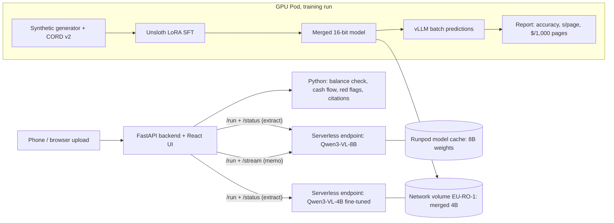

# LedgerLens

**Phone photos of messy small-business bank statements and invoices go in; checked transaction
rows, a cash-flow analysis, cited red flags and a credit memo come out.** Open vision models
(Qwen3-VL) run on **Runpod Serverless**, so a Southeast Asian lender can keep confidential documents
off US-hosted APIs and pay a known price per page.

The ML question behind it: *can a 4B model, LoRA fine-tuned on our own synthetic documents, match
an 8B model zero-shot on accuracy, speed and cost per 1,000 pages?*

> Everything here is fictional: synthetic businesses and fictional banks. The only real documents
> are the public CORD v2 receipts (CC BY 4.0).

## What it does

1. **Extract.** A page image goes to a Serverless endpoint. vLLM reads it into a strict JSON schema
   (structured decoding), validated with Pydantic.
2. **Check.** Code, not the model, checks every row against the printed running balance. A row
   whose balance proves the money went the other way is moved between debit and credit and
   flagged; rows that still don't add up are shown red for the analyst.
3. **Analyse.** Code computes monthly cash flow, balances, customer concentration and red flags
   (returned cheques, round trips, large cash deposits…). Every figure cites its page and row.
4. **Write.** The model writes the memo prose from those computed numbers only, streamed over
   `/stream`. Citations in the memo jump back to the evidence row.

## Architecture



## Runpod setup

| Piece | Choice | Why |
|---|---|---|
| Worker | `worker/handler.py`: a generator handler that starts `vllm serve` in-process at cold start; tasks `extract`, `memo` (streamed), `health` | One engine per worker; streaming memo over `/stream` |
| Image | `worker/Dockerfile` on `vllm/vllm-openai:v0.31.0-cu129`, built by Runpod's GitHub integration from the `deploy` branch | No local Docker; pushes to `main` never rebuild by accident (`scripts/release-worker.sh` ships) |
| 8B weights | Runpod **model cache** (`Qwen/Qwen3-VL-8B-Instruct`, pinned commit) | 16.3 GiB loaded in 5.7 s; no download at cold start |
| Fine-tuned 4B weights | **Network volume** (`MODEL_PATH`), same image and template | No rebuild or upload to swap models; pins the endpoint to EU-RO-1 |
| Scaling | Active 0, max 2, idle 60 s, FlashBoot on, queue-delay scaling 4 s, timeout 600 s | Nothing bills while idle; one Active worker only for the demo hour |
| GPUs | 32 GB class (RTX 5090 / RTX PRO 4500), CUDA ≥ 12.9 | The 8B in bf16 fits 32 GB at 8,192 tokens; older drivers can't start the image |
| Safety | Image size checked before decoding (decompression bombs); engine start failures fail jobs fast with the error instead of crash-looping paid workers | Both found or hardened during the build (see `docs/BUILD_LOG.md`) |

### Measured (8B, RTX 5090, 9 Oct)

| | Value |
|---|---|
| Warm statement page | 13.7–15.1 s execution, 0.13–1.4 s queue |
| Cold start | ~3.5 min (torch.compile ~27 s and CUDA-graph capture ~63 s are the big parts) |
| Serverless cost, warm | ≈ **$6.0–6.6 per 1,000 pages** at $0.000439/s |

## Results: 8B zero-shot vs 4B zero-shot vs 4B fine-tuned

All three on the same GPU (RTX PRO 4500), same prompt, schema and pixel cap. Row F1 = rows read
exactly right, from the model's own answer. Full results, breakdowns and failure analysis:
[`docs/REPORT.md`](docs/REPORT.md).

| | 8B, no training | 4B, no training | **4B fine-tuned** |
|---|---:|---:|---:|
| Unseen statement layouts (1,499 pages) | 0.578 | 0.614 | **0.965** |
| Seen layouts, new businesses (291) | 0.823 | 0.745 | **0.960** |
| Real CORD receipts (98) | 0.396 | 0.259 | **0.765** |
| Red flags found (unseen layouts) | 0.66 | 0.63 | **0.96** |
| Seconds per page, batched | 2.58 | 1.72 | **1.28** |
| $ per 1,000 pages, batched ($0.72/h) | 0.52 | 0.34 | **0.26** |

Served live on Serverless (warm, one page at a time): 8B ~14 s per page (≈ $6 per 1,000), fine-tuned
4B 7–11 s depending on the GPU it gets (RTX 5090 / 4090; ≈ $3 per 1,000 either way). The fine-tune's weak spot is heavy photo damage (row F1 0.87). Phone photos
of printed pages (the third test set) are pending.

## Data

- **Synthetic statements and invoices** (`src/ledgerlens/datagen`): 400 fictional businesses in
  Singapore, Malaysia and Indonesia, six months of seeded cash flow each, local currencies and
  payment rails, mixed-language descriptions, planted anomalies (about 27% of businesses clean),
  6 statement layouts and 2 invoice layouts, rendered in headless Chromium with seeded phone-photo
  damage. Answers are exact because the generator printed them.
- **Real receipts:** CORD v2 (Indonesian receipts, CC BY 4.0). Its train split goes into training;
  its test split is a held-out real-document test.
- **Leakage guards:** splits by business; two statement layouts appear only in test.

| Split | Synthetic | CORD | Total |
|---|---|---|---|
| Train | 2,396 | 771 | 3,167 |
| Validation | 289 | 99 | 388 |
| Test | 1,790 (1,499 unseen-layout, 291 seen-layout) | 98 | scored separately |

## Run it

```sh
uv sync && uv run ruff check . && uv run ruff format --check . && uv run pytest -q
```

- **Demo app, offline** (cached sample results): see `app/README.md`; `DEMO_MODE=1`, port 8090.
- **Demo app, live:** set `RUNPOD_ENDPOINT_8B` (and `RUNPOD_ENDPOINT_FT`); the key is read from
  `runpodctl`'s config, never from the browser.
- **One page from the command line:**
  `uv run python worker/client.py extract --endpoint-id <id> --image page.png --doc-type statement`
- **Training and evaluation on a GPU Pod:** `train/README.md` and `train/run_pod.sh`
  (`train/run_pod.sh` runs every stage, resumable by stage markers).

## Limitations and the synthetic-to-real gap

- Statements and invoices are synthetic. The real-document checks are CORD receipts (a different
  document type) and phone photos of printed synthetic pages. A real lender deployment would start
  with ~50 labelled real statements and a shadow period next to analysts.
- The fine-tune sees real CORD train receipts; the 8B baseline sees none. CORD test receipts are
  never trained on.
- Zero-shot, the 8B reads digits well but not the accounting convention (debit vs credit); the
  balance check fixes direction only where the printed balance proves it, and reports raw model
  accuracy separately.

## Repo map

```
src/ledgerlens/  schema, datagen, analytics, direction (balance check), eval/score, images (pixel cap)
worker/          Serverless handler, Dockerfile, prompts, REST client
train/           dataset builder (+CORD), Unsloth LoRA SFT, vLLM batch predict, report, run_pod.sh
app/             FastAPI backend + React/Vite frontend
docs/            DECISIONS (what we chose and why), BUILD_LOG (every step and dollar), REPORT (results)
```
