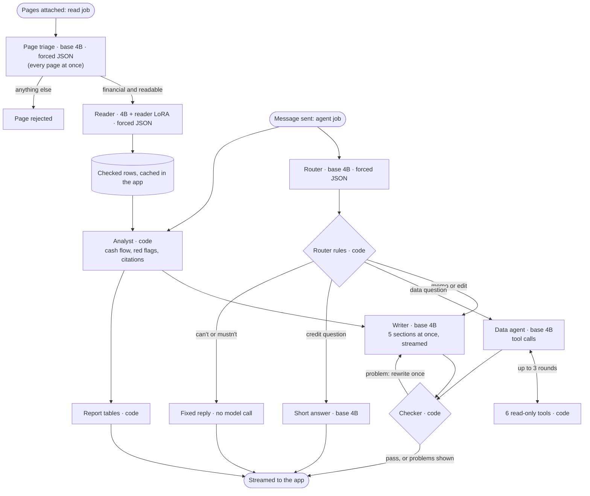
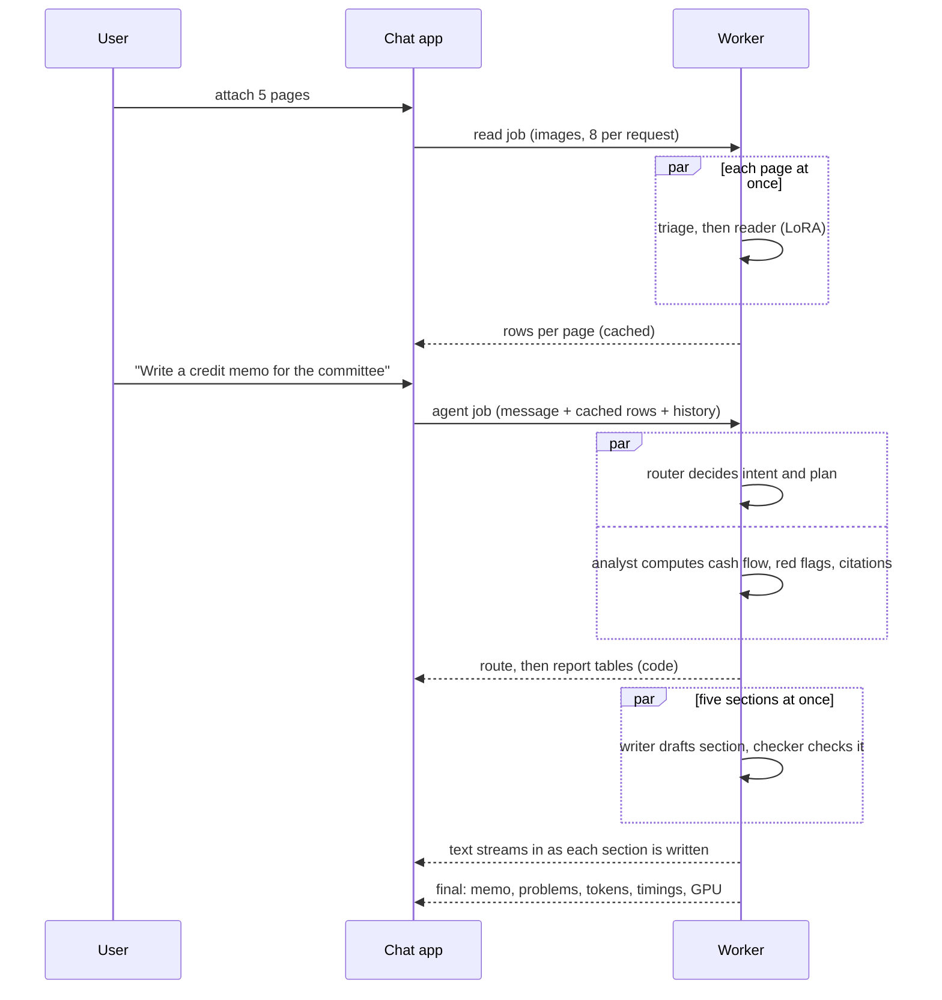

# How the credit assistant works

The credit assistant (`/assistant` in the app) is a small team of agents inside **one Runpod
Serverless worker** (endpoint `cuvgn5z2av09my`). Every model agent is the same
**Qwen3-VL-4B-Instruct** in one vLLM engine; the trained reader is a **LoRA adapter** (small add-on
weights) that vLLM switches on per request. Arithmetic, lookups and checks are plain Python, because
code doesn't invent numbers. Anything that doesn't depend on another step runs at the same time.

Code: `worker/agent.py` (orchestration), `src/ledgerlens/agent/` (prompts, tools, checker, rules,
edits, report, limits), `src/ledgerlens/analytics.py` (cash flow and red flags). Measured results:
[`REPORT.md`](REPORT.md) §3.

## The team

| Agent | Model or code | Input | Output | Loop |
|---|---|---|---|---|
| Page triage | base 4B, image capped at 0.5 MP | one page image | forced JSON: is it a financial document, type, readable | no |
| Reader | 4B + `reader` LoRA, image capped at 2 MP | one accepted page | forced JSON rows, validated by the same Pydantic schema as training | no |
| Router | base 4B | the message, whether a memo exists, the last 4 turns | forced JSON: intent, plan, sections to edit, reason | no |
| Router rules | code | the router's answer and the message | a corrected intent (recorded in the `route` event) | no |
| Analyst | code | all checked rows | monthly cash flow, balances, top payer, red flags, reconciliation, citations | no |
| Data agent | base 4B | the question and tool results | tool calls, then a cited answer | up to 3 tool rounds |
| Writer | base 4B | one section's figures and the plan | streamed text with `[page:row]` citations | rewritten once if the checker objects |
| Checker | code | a section or answer and the data it came from | a list of problems | sends a section back once |

Every model call runs at temperature 0. The router, triage and reader use vLLM's structured output,
so they can only return valid JSON in their schema. Document text is treated as data, never as
instructions.

## Two jobs: read on attach, then answer on send

The app sends **two kinds of job** to the same endpoint:

1. **`read`**, the moment pages are attached. Each page runs triage, then the reader, on its own;
   all pages run at once. A page that isn't a financial document, or isn't readable, is rejected
   before the reader runs. Rows come back as `rows` events and the app caches them. So reading
   usually finishes while the user is still typing.
2. **`agent`**, when the user presses send. The app sends the message, the **cached rows** (not the
   images), any pages not read yet, the last 10 turns and the last memo.

## Router: what does the user want?

The router returns one of six intents: `memo`, `ask_data`, `edit_memo`, `knowledge` (a general
credit question), `capabilities` ("what can you do?") or `off_topic`. For a memo it also plans the
audience, length (short, standard or long), focus and language (English, Indonesian, Malay or
Chinese).

The 4B router got some kinds of message wrong too often, so **code rules run after it**, in order:

1. A question about what the assistant can do gets the fixed capabilities answer.
2. A request to change a name, a figure or a table row is refused: those come from the documents.
3. Removing or restoring a whole section is an edit, even if the router said otherwise.
4. A wording change the router took for a document-fact edit goes to the writer.
5. A memo, data question or edit with no statements loaded gets "attach statements first".
6. An edit with no memo yet becomes a new memo.

Fixed replies (capabilities, refusals, "no documents", off-topic) make no further model call. With
these rules the router picked the right job in 97.5% of 198 test messages in four languages
(REPORT, E2).

## Reading and checking pages

- **Balance check** (`check_direction`): on statements, a row is moved between debit and credit only
  when the printed running balance proves the money went the other way. Rows that still don't add
  up are flagged for the analyst, never silently changed.
- **Pages must join up:** for each account, a page must open at the previous page's closing balance.
  A gap becomes a `balance_gap` red flag (a missing, out-of-order or misread page).

## Analyst (code)

`analyze` computes monthly money in, money out and net (partial months marked), totals, average and
minimum balance, the largest payer's share of money in, and six kinds of red flag:

| Red flag | Rule |
|---|---|
| `returned_cheque` | keywords such as RTN or 退票 |
| `round_trip` | money out, then 99–100% of it back from the same party within 10 days |
| `large_cash_deposit` | over 3× the median credit and marked as cash (CASH, TUNAI, 现金) |
| `customer_concentration` | one payer above half of all money in |
| `unreconciled_page` | a page whose rows don't add up to its printed balances |
| `balance_gap` | a page that doesn't open where the previous one closed |

Every figure carries its `[page:row]` citation.

## Data agent and its tools

For questions such as "who is the largest payer?", the data agent uses **native tool calling**
(vLLM's Hermes parser). The tools are the only thing a model can call. They are read-only code over
the checked rows, and code checks every argument.

| Tool | What it returns |
|---|---|
| `find_rows(text, month, min_amount, direction, limit, sort)` | matching rows, by date or largest amount first |
| `monthly_totals()` | money in, out and net per month |
| `top_counterparties(n, direction)` | the largest payers or payees |
| `list_findings()` | every red flag, with a count per type |
| `flag_detail(index)` | one red flag in full |
| `balance_on(day)` | the balance on a date |

- Up to **3 rounds**, up to **5 calls per round**; the calls in one round run at the same time.
- When the rounds run out, the model must answer with what it has (no more tools).
- **Name placeholders:** in tool results, non-Latin names (for example Chinese business names)
  become `NAME_1`, `NAME_2`. Code puts the real names back in the answer. Without this the model
  sometimes swapped a name for a famous brand; with it, payer questions went from 5/10 to 10/10.

## Writer: the memo as five sections

The writer drafts **five sections at once**, one model request each, in one GPU batch. Each section
sees only the figures it needs:

| Section | Fed with |
|---|---|
| Summary | period totals, red flags, top payer's share |
| Cash flow | monthly figures, period totals, average and minimum balance |
| Concentration | top payer's share |
| Red flags | red flags, reconciliation |
| Questions for the applicant | red flags, reconciliation, top payer's share |

Length per section: short 60, standard 120 (default) or long 220 words. **Code builds the rest of the
report:** the header (borrower, bank, account, period, evidence), key figures, the monthly table, the
red-flag table and the reconciliation table. The model writes only the commentary, so the tables are
always right.

**Edits** ("make the red flags shorter", "remove the second question", "translate to Bahasa"):

- Only the sections the request touches are rewritten; the others stay byte for byte.
- Removing a whole section, sentence, bullet or question is done **in code** when exactly one
  section matches, so it is exact.
- "Shorter" must come back at no more than 3/5 of the previous length; "longer" at least 1.3×.
- A rewrite that switches language without being asked keeps the previous text and says so.

## Checker (code): every number must exist

As each section or answer finishes, the checker looks for:

- **Unverified figures:** any number (including rounded, "455.5M"-style and Indonesian-format
  numbers) that isn't in the data the section was given.
- **Bad citations:** a `[page:row]` that points to no real row, or citations dropped by an edit.
- **Names** in a data answer that aren't in the tool results.
- **Wrong language**, **too long**, **missing heading**, and **edit not applied** (an edit that
  changed almost nothing).

A section with problems is rewritten **once**; edits that weren't applied get one more try. If
problems remain, the text is kept and the problems are shown on screen next to the section, never
hidden.

## What runs at the same time

- Reading every attached page (before the user presses send).
- The router and the analyst.
- The five memo sections, each checked as soon as it lands.
- The tool calls within one data-agent round.
- Up to 4 jobs per worker (Runpod's `concurrency_modifier`), so one warm GPU serves several chats.

Text streams back in batches (every 64 characters or 200 ms), because each yield is one request to
Runpod. Event types: `step`, `triage`, `rows`, `route`, `report`, `deltas`, `section_reset`,
`section`, `tool`, `log`, `error`, `final`. The full list is in
[`worker/README.md`](../worker/README.md#chat-and-page-reading).

## Limits

Message 2,000 characters; history 10 turns; up to 8 new pages per request and 100 documents per
turn; request body 9 MB; 500 rows per document and 10,000 in all; 3 tool rounds of 5 calls.

## Measured

All live on the endpoint unless noted (details in [`REPORT.md`](REPORT.md) §3):

| | Result |
|---|---|
| Warm memo | 7.9 s, $0.0036 (the old one-shot memo took 50–106 s) |
| Warm data answer | 4.1 s, $0.0020 |
| Router, right intent (E2, 198 messages, en/id/ms/zh) | 97.5% |
| Data questions answered right (E4, 80) | 100% |
| Memos with all sections and valid citations (E5, 30) | 30/30 |
| Memo edits followed (E6, 104 edits) | 97.1%; all 24 must-refuse edits refused |
| Cold start (image pull, model load, compile) | 3–8 minutes |

## What the model never does

- **Arithmetic:** every total, share and balance comes from code.
- **Recommend approve or decline:** that stays with the credit officer.
- **Read a person's credit history:** this is a company cash-flow review from the business's own
  bank statements and invoices.
